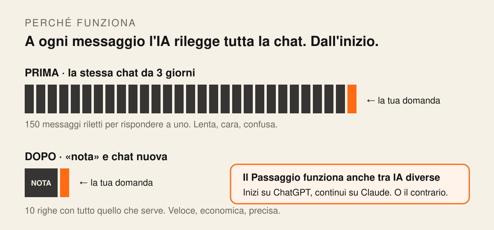
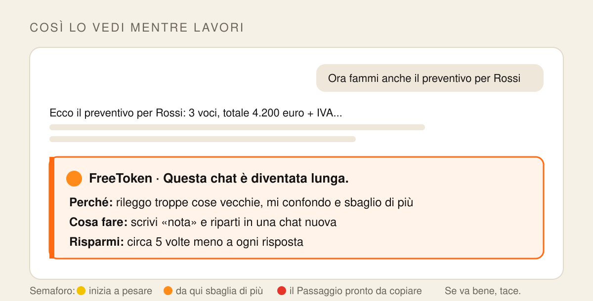
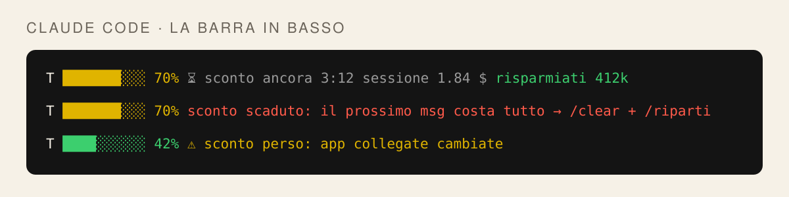

# 🪙 FreeToken

**La tua IA ti avvisa quando stai consumando troppo. E ti dice cosa fare.**

Creato da [Giando Santamaria](#chi-ha-creato-freetoken), il primo in Italia a scrivere un libro su ChatGPT.

**[▶ Prova subito il calcolatore gratuito](https://giandoms.github.io/FreeToken/strumenti/calcolatore.html)** · nessuna registrazione, funziona nel browser

Funziona su **ChatGPT**, **Claude** (chat, app e Cowork), **Claude Code** e **Codex**. Gratis, in italiano, si installa da qui come plugin.

---

## Il problema, in tre righe

A ogni messaggio l'IA rilegge **tutta** la chat, dall'inizio. Più la chat è lunga e piena di roba, più ogni risposta consuma e più l'IA si confonde.

Quasi tutti fanno l'opposto di quello che conviene: tengono aperta la stessa chat per giorni «così si ricorda tutto», incollano documenti interi, chiedono di rifare tutto per cambiare una virgola. Risultato: limiti raggiunti a metà giornata, risposte che peggiorano, conti che salgono.



## Come si vede

Lavori come sempre. Quando la chat consuma troppo, in fondo alla risposta compare l'avviso: **cosa succede, perché ti costa, cosa fare**.



Funziona come un semaforo, e ogni colore scatta una volta sola:

- 🟡 **la chat inizia a pesare**: ti spiega perché, e ti chiede se stai ancora facendo lo stesso lavoro;
- 🟠 **da qui l'IA sbaglia di più**: ti consiglia di ripartire;
- 🔴 **riparti adesso**: ti scrive già il Passaggio, 10 righe da copiare in una chat nuova. Non devi neanche chiederlo.

Se va tutto bene, non dice niente. Un guardiano dei consumi che parla troppo sarebbe il primo spreco.

## Installalo in un minuto

FreeToken è **un plugin**: un pacchetto unico, con dentro la skill che interviene da sola, i comandi e, dove l'app lo permette, il pilota automatico. Lo stesso pacchetto funziona su Claude e su ChatGPT/Codex. Si installa direttamente da questa pagina GitHub.

| Dove lo usi | Come lo installi | Cosa ottieni |
|---|---|---|
| **Claude** (web, app, Cowork) | **Personalizza → Plugin → Aggiungi → Aggiungi marketplace → Aggiungi da un repository** → scrivi `Giandoms/FreeToken` → **Sincronizza** → **+** su Freetoken | In chat: la skill che interviene da sola. In Cowork: anche il pilota automatico |
| **Claude Code** | Scrivi `/plugin install freetoken --marketplace Giandoms/FreeToken` | Il pilota automatico completo, con i numeri veri |
| **Codex** | Nel Terminale: `codex plugin marketplace add Giandoms/FreeToken` e poi `codex plugin add freetoken@freetoken` | La skill che interviene da sola e i comandi |
| **ChatGPT** | Dopo il comando qui sopra, FreeToken compare tra i plugin dell'app desktop di ChatGPT: aprilo e premi **+**. Nelle aziende, l'amministratore può importare il marketplace da GitHub per tutti | La skill che interviene da sola |
| **Ovunque, in 30 secondi** | Copia [`INCOLLA-QUESTO.txt`](INCOLLA-QUESTO.txt) nelle istruzioni personalizzate (ChatGPT, Claude, Gemini) | Il semaforo sempre acceso, in versione leggera |

**Il consiglio:** plugin **e** blocco nelle istruzioni. Il plugin porta tutti i comandi, il blocco garantisce che l'avviso ci sia in ogni chat.

Guide passo passo: [Claude e Cowork](claude/COME-SI-USA.md) · [ChatGPT](chatgpt/COME-SI-USA.md) · [Codex](codex/COME-SI-USA.md) · [attività programmate di Cowork](cowork/COME-SI-USA.md).

> I GPT personalizzati di ChatGPT verranno ritirati l'11 dicembre 2026 e sostituiti dai plugin. Per questo FreeToken è un plugin e non un GPT.

## Come fa a intervenire da solo

Non devi richiamarlo. Lavora su tre livelli, e più livelli attivi, più è affidabile.

| Livello | Dove | Come funziona | Quanto è affidabile |
|---|---|---|---|
| **1. Pilota automatico** | Claude Code, Cowork | Controlli agganciati all'app che partono **prima** che il messaggio venga inviato. Leggono i consumi veri e possono fermare uno spreco. All'avvio mettono anche le regole FreeToken nella sessione | Sempre, senza eccezioni |
| **2. Skill autonoma** | Claude (web, app), ChatGPT, Codex | L'IA conosce sempre il nome e la descrizione di FreeToken. Quando riconosce un segnale (chat lunga, testo enorme, cambio di argomento, correzione) la apre da sola e aggiunge l'avviso | Quasi sempre: decide il modello, quindi non è garantito al cento per cento |
| **3. Blocco sempre acceso** | Ovunque | Le regole stanno nelle istruzioni personalizzate, quindi sono presenti in ogni messaggio | Sempre, in versione leggera e con cifre stimate |

Quanto costa tenerlo acceso? Claude Code stima circa **230 token per sessione**: meno di quanto costa un «grazie» in una chat lunga.

## Le parole magiche

Scrivile in chat quando ti servono.

| Scrivi | Cosa ottieni |
|---|---|
| `nota` | **Il Passaggio**: 10 righe con obiettivo, decisioni, materiali e prossimo passo. Lo incolli in una chat nuova e riparti leggero senza perdere niente. Funziona anche per passare da ChatGPT a Claude e viceversa |
| `quanto` | se la chat è leggera, media o pesante, e se conviene ripartire |
| `comprimi` | il tuo testo più corto, senza perdere numeri, nomi e scadenze |
| `dieta` | le tue istruzioni personalizzate dimagrite, con quanto risparmi su 100 messaggi |
| `pagella` | un voto da 1 a 10 a come usi l'IA, e le 3 cose da cambiare subito |
| `modello` | quale modello conviene per il lavoro che stai facendo, perché, e quanti euro risparmi |
| `preventivo` | prima di un lavoro grande: come dividerlo per non bruciare i limiti |
| `calcolatore` | il calcolatore: quanto pesa un testo e se conviene ripartire |
| `regole` | le 7 regole d'oro |

`nota` e `quanto` funzionano già con il solo blocco. Le altre arrivano con il plugin.

## Cosa ci guadagni

- **Arrivi ai limiti più tardi** se sei in abbonamento, **spendi meno** se paghi a consumo.
- **Risposte migliori**: in una chat corta e pulita l'IA si perde meno e non ripete errori già corretti.
- **Cambi IA senza ricominciare**: il Passaggio porta il lavoro da una chat all'altra, e da un'IA all'altra.
- **Smetti di pagare i lavori automatici a vuoto**: con la guardia, un'attività programmata che non trova niente si ferma subito invece di lavorare a vuoto. È qui che si libera più spazio.
- **Impari le abitudini giuste** senza studiare niente: te le dice lui, al momento giusto.

## Le 7 regole d'oro

1. Una chat per lavoro. Cambi argomento: nota e chat nuova.
2. Pausa lunga: nota prima, chat nuova dopo.
3. Manda solo la parte che serve: mai documenti interi se serve un paragrafo.
4. L'errore si toglie tornando indietro (la matita sul tuo messaggio), non correggendo dopo.
5. Istruzioni fisse corte, app collegate solo se servono, memoria salvata pulita.
6. Il modello giusto per il lavoro: potente per decidere, leggero per eseguire. Si sceglie all'inizio, non a metà.
7. I lavori automatici partono solo quando c'è davvero lavoro.

Vuoi capire il perché di ognuna, con esempi prima e dopo? Leggi **[le 23 strategie](STRATEGIE.md)**. Molte vanno contro il buon senso.

## Il calcolatore gratuito

**[Aprilo online](https://giandoms.github.io/FreeToken/strumenti/calcolatore.html)**, oppure apri [`strumenti/calcolatore.html`](strumenti/calcolatore.html) dalla cartella scaricata. Chi installa FreeToken lo ha già dentro il plugin: scrivi `calcolatore`. Incolli un testo e vedi quanto ti costa tenerlo nella chat, e se ti conviene continuare o ripartire dalla nota. Funziona senza internet, niente esce dal tuo computer.

---

## Claude Code: il pilota automatico

Qui FreeToken non si limita ad avvisare: legge i consumi veri, ferma gli sprechi prima che succedano e ti fa il conto di quanto hai risparmiato.

```
/plugin install freetoken --marketplace Giandoms/FreeToken
```

Serve Python 3.8 o successivo, che su Mac e Linux c'è quasi sempre. Il plugin porta la skill, i comandi e i controlli automatici.

**La barra in basso (facoltativa).** I plugin non possono installare la barra di stato, quindi è un passo a parte:

```bash
git clone https://github.com/Giandoms/FreeToken.git
python3 FreeToken/claude-code/install.py --solo-barra
```

Preferisci non usare i plugin? `python3 FreeToken/claude-code/install.py` installa tutto a mano, e `--rimuovi` lo toglie rimettendo la tua barra di prima. Su Windows scrivi `python` invece di `python3`.

### Cosa fa da solo

| Quando | Cosa succede |
|---|---|
| Incolli un testo enorme | **Ti ferma** e ti dice cosa mandare invece. Se ti serve davvero tutto, rimandalo iniziando con `!!` |
| Torni da una pausa con la chat piena | **Ti ferma una volta**: lo sconto sulla chat è scaduto e il messaggio costerebbe a prezzo pieno. Ti propone `/clear` + `/riparti` |
| Claude prova a leggere un file gigante o una cartella che non serve mai | **Lo ferma**, e Claude cerca da solo solo la parte giusta |
| La chat arriva a metà, al 70%, all'85% | 🟡 🟠 🔴 con la mossa giusta per quel momento |
| «grazie» o «ok» a chat piena | Ti dice quanto ha appena consumato |
| Chiedi di rifare un file intero | Ti suggerisce di chiedere solo le modifiche |
| «guarda tu», «cerca nel progetto» | Ti chiede di indicare il file |
| Un'app collegata restituisce un risultato enorme | Te lo segnala e ti dice come chiederne meno |
| Riprendi una sessione vecchia e grande | Ti dice quanto costerà il primo messaggio |
| Chiedi una mail o una traduzione a Opus | Ti suggerisce Sonnet e quanto risparmi in euro (circa 0,80 € ogni 25 richieste) |
| Chiedi architettura o strategia a un modello leggero, o fallisce due volte | Ti suggerisce il modello più potente, con il conto onesto |
| Stai per cambiare modello a metà | Ti avvisa che perdi lo sconto, con la cifra in euro |
| Apri un progetto (una volta al giorno) | Check-up: istruzioni troppo lunghe, troppe app collegate |

Ogni blocco scatta **una volta sola**: FreeToken ti avvisa, non ti impedisce di lavorare. Vuoi solo avvisi, senza blocchi? Scrivi `"modalita": "morbida"` in `~/.freetoken/config.json`.

### La barra in basso



Il conto alla rovescia (`⏳ 3:12`) è il dato che nessuno ti mostra: finché scorre, la chat costa circa un decimo. Quando arriva a zero, il messaggio dopo costa tutto. Se avevi già una barra, resta sopra la nostra.

### I comandi

| Comando | A cosa serve |
|---|---|
| `/nota` | salva in 20 righe dove sei arrivato |
| `/riparti` | dopo `/clear`, riparte dalla nota invece che da 150 messaggi |
| `/asciutto` | da qui in avanti risposte brevi e modifiche mirate |

### Il conto del risparmio

```bash
python3 FreeToken/plugins/freetoken/scripts/freetoken.py conto
```

```
🪙 FREETOKEN · il tuo conto dal 03/11/2026 · 41 sessioni

RISPARMIATI (stima prudente, in token equivalenti a prezzo di input)
  Incolla enormi fermati                   12 volte      1,9M   ≈     6,84 €
  File letti interi evitati                37 volte      2,6M   ≈     9,36 €
  Ripartenze a cache fredda evitate         9 volte      1,4M   ≈     5,04 €
  TOTALE                                                 5,9M   ≈    21,24 €

SPRECHI RILEVATI (qui c'è ancora da guadagnare)
  Risultati pesanti entrati nella chat     22 volte      880k   ≈     3,17 €
  Sessioni riprese a cache scaduta          6 volte      910k   ≈     3,28 €
```
*(cifre di esempio)*

Come si calcola: ogni cosa che entra nella chat si paga per intero la prima volta e poi circa un decimo a ogni richiesta successiva. Contiamo le richieste vere della sessione; quando non le abbiamo usiamo una media prudente. Le cifre sono in euro: FreeToken riconosce il modello che usi e prende il suo prezzo (listino API di novembre 2026, cambio 1 dollaro = 0,90 euro). Prezzo e cambio li puoi cambiare in `~/.freetoken/config.json`.

### Gli altri strumenti

```bash
python3 FreeToken/plugins/freetoken/scripts/freetoken.py audit      # lavori ripetuti che girano a vuoto, ultimi 30 giorni
python3 FreeToken/plugins/freetoken/scripts/freetoken.py pagella    # check-up del progetto
python3 FreeToken/plugins/freetoken/scripts/freetoken.py misura FILE  # quanto pesa un file nella chat
python3 FreeToken/plugins/freetoken/scripts/freetoken.py modello    # quale modello conviene e quanti euro risparmi
```

Per i lavori automatici c'è anche `claude-code/esempi/guardia.sh`: sveglia l'IA solo se c'è davvero qualcosa da fare.

---

## Detto chiaro

- **Nelle chat di ChatGPT, Claude e Codex** l'IA non vede il contatore vero dei consumi: le cifre degli avvisi sono stime. Bastano per decidere. Il blocco automatico esiste solo dove l'app permette controlli agganciati (Claude Code e Cowork).
- **La skill autonoma la attiva il modello.** Riconosce i segnali quasi sempre, ma non è una garanzia: per questo conviene affiancarle il blocco nelle istruzioni personalizzate.
- **La regola non vale sempre.** Una chat lunga conviene ancora se stai facendo lo stesso lavoro e ti serve tutto quel contesto. FreeToken ti avvisa, la decisione resta tua.
- **Privacy.** Niente esce dal tuo computer. Su Claude Code il registro dei risparmi sta in `~/.freetoken/` e non contiene i tuoi testi.

## Cosa c'è nella cartella

```
FreeToken/
├── INCOLLA-QUESTO.txt        il blocco da incollare, vale ovunque
├── STRATEGIE.md              le 23 strategie con esempi prima e dopo
├── plugins/freetoken/        IL PLUGIN (Claude, ChatGPT, Codex)
│   ├── skills/freetoken/     la skill che interviene da sola, con il calcolatore
│   ├── commands/             /nota  /riparti  /asciutto
│   ├── claude-hooks/         il pilota automatico per Claude Code e Cowork
│   └── scripts/              conto, audit, pagella, barra
├── .claude-plugin/           il catalogo per Claude
├── .agents/plugins/          il catalogo per ChatGPT e Codex
├── chatgpt/ claude/ codex/ cowork/   le guide passo passo
├── claude-code/              installazione a mano ed esempi
├── scarica/                  la skill in zip, per chi non usa i plugin
├── strumenti/                il calcolatore gratuito
├── assets/                   le immagini di questa pagina
└── tests/                    il collaudo
```

## Chi ha creato FreeToken


**Giando Santamaria** è stato il primo in Italia a scrivere un libro su ChatGPT e a parlarne, quando ancora quasi nessuno lo faceva. La Rai lo ha definito il «Facilitatore AI». Presidente AI.MI, il primo ente professionale che forma i futuri esperti di AI per PMI e pubblica amministrazione.

🌐 [giandosantamaria.it](https://www.giandosantamaria.it) · 🏛️ [AI.MI](https://aimanageritalia.it)

---

## Contribuire

Hai trovato uno spreco che FreeToken non vede? Apri una segnalazione (Issue) con un esempio di prima e dopo. Le idee migliori entrano nelle prossime versioni, con il tuo nome.

---

Licenza MIT: usalo, copialo, miglioralo. Se ti è stato utile, lascia una ⭐ al progetto.
