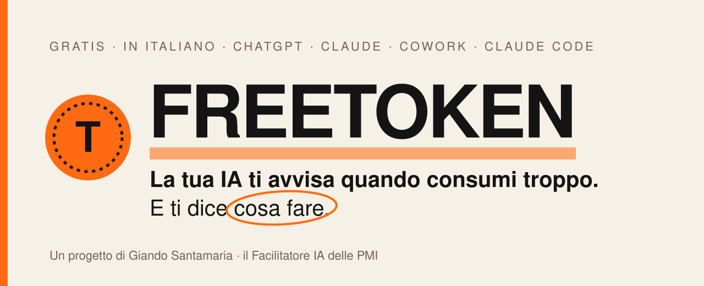
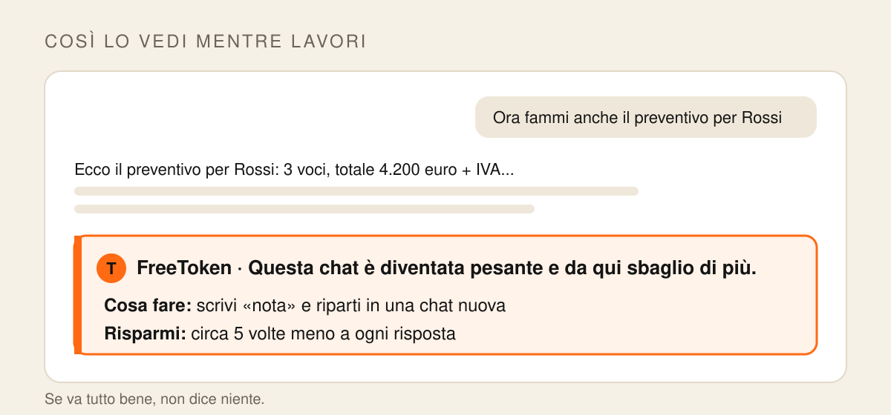

# 🪙 FreeToken

**La tua IA ti avvisa quando stai consumando troppo. E ti dice cosa fare.**

**[▶ Prova subito il calcolatore gratuito](https://giandoms.github.io/FreeToken/strumenti/calcolatore.html)** · nessuna registrazione, funziona nel browser

Funziona su **ChatGPT**, **Claude** (chat, app e Cowork) e **Claude Code**. Gratis, in italiano, senza installare niente sulle chat.

---

## Il problema, in tre righe

A ogni messaggio l'IA rilegge **tutta** la chat, dall'inizio. Più la chat è lunga e piena di roba, più ogni risposta consuma e più l'IA si confonde.

Quasi tutti fanno l'opposto di quello che conviene: tengono aperta la stessa chat per giorni «così si ricorda tutto», incollano documenti interi, chiedono di rifare tutto per cambiare una virgola. Risultato: limiti raggiunti a metà giornata, risposte che peggiorano, conti che salgono.


## Come si vede

Lavori come sempre. Quando la chat consuma troppo, in fondo alla risposta compare l'avviso:



Se va tutto bene, non dice niente. Un guardiano dei consumi che parla troppo sarebbe il primo spreco.

## Installalo in un minuto

| Dove lo usi | Cosa fai | Guida |
|---|---|---|
| **ChatGPT** | Copi `INCOLLA-QUESTO.txt` nelle Istruzioni personalizzate | [chatgpt/COME-SI-USA.md](chatgpt/COME-SI-USA.md) |
| **Claude** (chat, app, Cowork) | Copi `INCOLLA-QUESTO.txt` nelle tue Istruzioni, e se vuoi carichi la skill | [claude/COME-SI-USA.md](claude/COME-SI-USA.md) |
| **Claude Code** | Lanci un comando e fa tutto da solo, con i numeri veri | [più sotto](#claude-code-il-pilota-automatico) |
| **Gemini e altre** | Copi `INCOLLA-QUESTO.txt` nelle istruzioni della Gem o dell'assistente | |

## Le parole magiche

Scrivile in chat quando ti servono.

| Scrivi | Cosa ottieni |
|---|---|
| `nota` | **Il Passaggio**: 10 righe con obiettivo, decisioni, materiali e prossimo passo. Lo incolli in una chat nuova e riparti leggero senza perdere niente. Funziona anche per passare da ChatGPT a Claude e viceversa |
| `quanto` | se la chat è leggera, media o pesante, e se conviene ripartire |
| `comprimi` | il tuo testo più corto, senza perdere numeri, nomi e scadenze |
| `dieta` | le tue istruzioni personalizzate dimagrite, con quanto risparmi su 100 messaggi |
| `pagella` | un voto da 1 a 10 a come usi l'IA, e le 3 cose da cambiare subito |
| `preventivo` | prima di un lavoro grande: come dividerlo per non bruciare i limiti |
| `calcolatore` | il calcolatore: quanto pesa un testo e se conviene ripartire |
| `regole` | le 7 regole d'oro |

`nota` e `quanto` funzionano già con il solo blocco. Le altre arrivano con il GPT o con la skill.

## Cosa ci guadagni

- **Arrivi ai limiti più tardi** se sei in abbonamento, **spendi meno** se paghi a consumo.
- **Risposte migliori**: in una chat corta e pulita l'IA si perde meno e non ripete errori già corretti.
- **Cambi IA senza ricominciare**: il Passaggio porta il lavoro da una chat all'altra, e da un'IA all'altra.
- **Smetti di pagare i lavori automatici a vuoto**: FreeToken ti avvisa quando crei un'attività programmata che consumerebbe anche senza niente da fare.
- **Impari le abitudini giuste** senza studiare niente: te le dice lui, al momento giusto.

## Le 7 regole d'oro

1. Una chat per lavoro. Cambi argomento: nota e chat nuova.
2. Pausa lunga: nota prima, chat nuova dopo.
3. Manda solo la parte che serve: mai documenti interi se serve un paragrafo.
4. L'errore si toglie tornando indietro (la matita sul tuo messaggio), non correggendo dopo.
5. Istruzioni fisse corte, app collegate solo se servono, memoria salvata pulita.
6. Il modello che ragiona decide, quello veloce esegue.
7. I lavori automatici partono solo quando c'è davvero lavoro.

Vuoi capire il perché di ognuna, con esempi prima e dopo? Leggi **[le 23 strategie](STRATEGIE.md)**. Molte vanno contro il buon senso.

## Il calcolatore gratuito

**[Aprilo online](https://giandoms.github.io/FreeToken/strumenti/calcolatore.html)**, oppure apri [`strumenti/calcolatore.html`](strumenti/calcolatore.html) dalla cartella scaricata. Chi installa FreeToken lo ha già: nella skill (scrivi `calcolatore`) e in Claude Code (`python3 claude-code/scripts/freetoken.py calcolatore`). Incolli un testo e vedi quanto ti costa tenerlo nella chat, e se ti conviene continuare o ripartire dalla nota. Funziona senza internet, niente esce dal tuo computer.

---

## Claude Code: il pilota automatico

Qui FreeToken non si limita ad avvisare: legge i consumi veri, ferma gli sprechi prima che succedano e ti fa il conto di quanto hai risparmiato.

```bash
git clone https://github.com/Giandoms/FreeToken.git
cd FreeToken
python3 claude-code/install.py
```

Riavvia Claude Code. Serve solo Python 3.8 o successivo. Su Windows scrivi `python` invece di `python3`. Per toglierlo: `python3 claude-code/install.py --rimuovi` (rimette anche la tua barra di stato di prima).

Si può installare anche come plugin: la cartella `claude-code` ha già tutto il necessario.

### Cosa fa da solo

| Quando | Cosa succede |
|---|---|
| Incolli un testo enorme | **Ti ferma** e ti dice cosa mandare invece. Se ti serve davvero tutto, rimandalo iniziando con `!!` |
| Torni da una pausa con la chat piena | **Ti ferma una volta**: lo sconto sulla chat è scaduto e il messaggio costerebbe a prezzo pieno. Ti propone `/clear` + `/riparti` |
| Claude prova a leggere un file gigante o una cartella che non serve mai | **Lo ferma**, e Claude cerca da solo solo la parte giusta |
| La chat arriva a metà, al 70%, all'85% | 🟡 🟠 🔴 con la mossa giusta per quel momento |
| «grazie» o «ok» a chat piena | Ti dice quanto ha appena consumato |
| Chiedi di rifare un file intero | Ti suggerisce di chiedere solo le modifiche |
| «guarda tu», «cerca nel progetto» | Ti chiede di indicare il file |
| Un'app collegata restituisce un risultato enorme | Te lo segnala e ti dice come chiederne meno |
| Riprendi una sessione vecchia e grande | Ti dice quanto costerà il primo messaggio |
| Stai per cambiare modello a metà | Ti avvisa che perdi lo sconto |
| Apri un progetto (una volta al giorno) | Check-up: istruzioni troppo lunghe, troppe app collegate |

Ogni blocco scatta **una volta sola**: FreeToken ti avvisa, non ti impedisce di lavorare. Vuoi solo avvisi, senza blocchi? Scrivi `"modalita": "morbida"` in `~/.freetoken/config.json`.

### La barra in basso


Il conto alla rovescia (`⏳ 3:12`) è il dato che nessuno ti mostra: finché scorre, la chat costa circa un decimo. Quando arriva a zero, il messaggio dopo costa tutto. Se avevi già una barra, resta sopra la nostra.

### I comandi

| Comando | A cosa serve |
|---|---|
| `/nota` | salva in 20 righe dove sei arrivato |
| `/riparti` | dopo `/clear`, riparte dalla nota invece che da 150 messaggi |
| `/asciutto` | da qui in avanti risposte brevi e modifiche mirate |

### Il conto del risparmio

```bash
python3 claude-code/scripts/freetoken.py conto
```

```
🪙 FREETOKEN · il tuo conto dal 03/11/2026 · 41 sessioni

RISPARMIATI (stima prudente, in token equivalenti a prezzo di input)
  Incolla enormi fermati                   12 volte      1,9M   ≈   9.40 $
  File letti interi evitati                37 volte      2,6M   ≈  13.10 $
  Ripartenze a cache fredda evitate         9 volte      1,4M   ≈   7.20 $
  TOTALE                                                 5,9M   ≈  29.70 $

SPRECHI RILEVATI (qui c'è ancora da guadagnare)
  Risultati pesanti entrati nella chat     22 volte      880k   ≈   4.40 $
  Sessioni riprese a cache scaduta          6 volte      910k   ≈   4.55 $
```
*(cifre di esempio)*

Come si calcola: ogni cosa che entra nella chat si paga per intero la prima volta e poi circa un decimo a ogni richiesta successiva. Contiamo le richieste vere della sessione; quando non le abbiamo usiamo una media prudente. Il prezzo lo imposti tu in `~/.freetoken/config.json`.

### Gli altri strumenti

```bash
python3 claude-code/scripts/freetoken.py audit      # lavori ripetuti che girano a vuoto, ultimi 30 giorni
python3 claude-code/scripts/freetoken.py pagella    # check-up del progetto
python3 claude-code/scripts/freetoken.py misura FILE  # quanto pesa un file nella chat
```

Per i lavori automatici c'è anche `claude-code/esempi/guardia.sh`: sveglia l'IA solo se c'è davvero qualcosa da fare.

---

## Detto chiaro

- **Su ChatGPT, Claude e Cowork** l'IA non vede il contatore vero dei consumi: le cifre degli avvisi sono stime. Bastano per decidere. Il blocco automatico esiste solo su Claude Code, perché solo lì si può agganciare un controllo prima che il messaggio parta.
- **La regola non vale sempre.** Una chat lunga conviene ancora se stai facendo lo stesso lavoro e ti serve tutto quel contesto. FreeToken ti avvisa, la decisione resta tua.
- **Privacy.** Niente esce dal tuo computer. Su Claude Code il registro dei risparmi sta in `~/.freetoken/` e non contiene i tuoi testi.

## Cosa c'è nella cartella

```
freetoken/
├── INCOLLA-QUESTO.txt   il blocco da incollare, vale ovunque
├── STRATEGIE.md         le 23 strategie con esempi prima e dopo
├── chatgpt/             il GPT completo e la guida
├── claude/              la skill per chat, app e Cowork, e la guida
├── claude-code/         il pilota automatico
├── strumenti/           il calcolatore gratuito
├── assets/              le immagini di questa pagina
└── tests/               il collaudo del pilota automatico
```

## Contribuire

Hai trovato uno spreco che FreeToken non vede? Apri una segnalazione (Issue) con un esempio di prima e dopo. Le idee migliori entrano nelle prossime versioni, con il tuo nome.

---

Un progetto di **Giando Santamaria**, il Facilitatore IA delle PMI · [giandosantamaria.it](https://www.giandosantamaria.it) · Licenza MIT: usalo, copialo, miglioralo.
